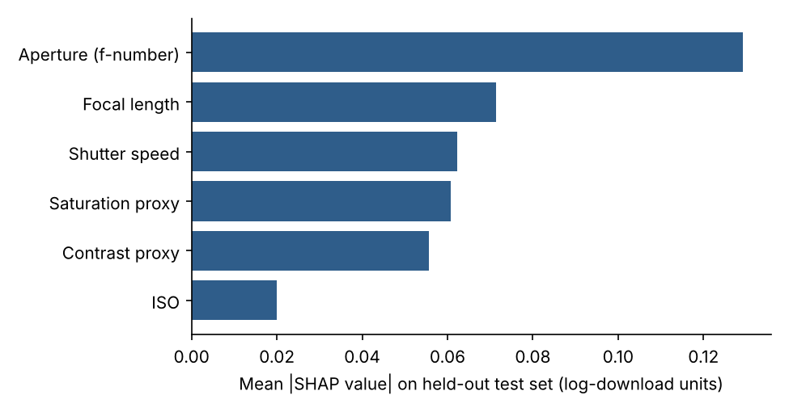
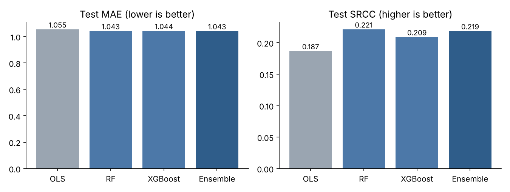
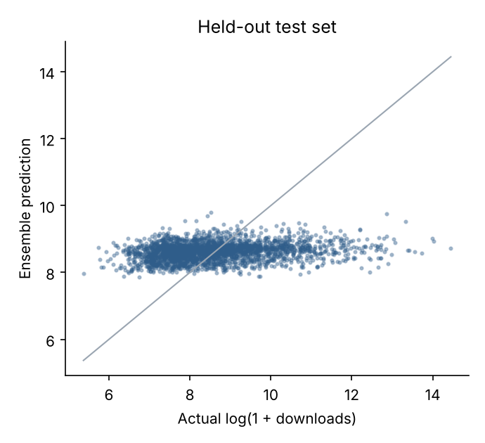

# Photo Aesthetics with Shapley Values

**Which camera settings and image statistics actually predict how popular a photo becomes, and by how much?**

This repository asks that question of 24,996 photos from the [Unsplash Lite dataset](https://github.com/unsplash/datasets). Each photo is described by its EXIF exposure settings and two post-processing proxies computed from the pixels. A Random Forest + XGBoost ensemble then learns to predict its log download count, and the prediction is explained per feature with SHAP (Shapley additive explanations).

[](https://colab.research.google.com/github/CodeOfDuty007/Shapley_reg_PhotoAnalysis/blob/main/notebooks/postprocessing.ipynb)

<p align="center">
  
</p>

---

## Contents

- [Key findings](#key-findings)
- [How it works](#how-it-works)
- [Repository layout](#repository-layout)
- [Quick start (no downloads, about 10 minutes)](#quick-start)
- [Full replication from raw Unsplash data](#full-replication-from-raw-unsplash-data)
- [Outputs](#outputs)
- [Limitations](#limitations)
- [Acknowledgements](#acknowledgements)

---

## Key findings

All numbers below come from `python pipeline/evaluate_holdout.py` on the shipped feature table. The split is a stratified 80 / 10 / 10 train / validation / test split (19,996 / 2,500 / 2,500 photos, seed 42). The target is `log(1 + downloads)`, with mean 8.62 and SD 1.35.

| Model (held-out test set) | MAE ↓ | RMSE ↓ | PLCC ↑ | SRCC ↑ |
|---|---:|---:|---:|---:|
| Predict the training mean | 1.068 | – | – | – |
| OLS (standardised, unregularised) | 1.055 | 1.331 | 0.167 | 0.187 |
| Random Forest (tuned) | 1.043 | 1.317 | **0.218** | **0.221** |
| XGBoost (tuned, early stopping) | 1.044 | 1.320 | 0.208 | 0.209 |
| RF + XGBoost ensemble (weights 0.5 / 0.5) | **1.043** | **1.317** | **0.218** | 0.219 |

<p align="center">
  
</p>

1. **Aperture is the strongest single signal.** It has the largest mean |SHAP| on the test set (0.129, about 1.8× the next feature) and was also ranked first in the in-sample run. The raw data shows the same pattern. Mean log-downloads rises steadily with f-number, from 8.29 at f/2 or wider to 8.94 at f/11 or narrower. That is roughly **1.9× more downloads** for narrow-aperture photos, which are typically landscapes and architecture, than for wide-open portrait or low-light shots.
2. **Camera settings and simple pixel statistics explain only a small part of popularity.** The ensemble beats a predict-the-mean baseline by about 2.4% in MAE, and its rank correlation with the truth is 0.22. Most of the variance in downloads depends on things these features don't see, such as subject, composition, photographer reach and upload date.
3. **The in-sample numbers are inflated.** Stage 1 fits and predicts on the same rows for attribution purposes, which gives PLCC = 0.53 and MAE = 0.94 (see `notebooks/postprocessing.ipynb`). On held-out photos PLCC falls to 0.22. Report the held-out figures.
4. **Trees beat linear regression, but only a little.** RF and XGBoost improve on OLS (SRCC 0.22 vs 0.19), which points to mild non-linearity. The exposure-triangle features are correlated, and the VIF check in stage 1 measures that collinearity before modelling.
5. **ISO carries almost no information here.** It has the lowest mean |SHAP| (0.020) and a raw Spearman correlation of 0.003 with the target.
6. **Data quality matters.** About 13–15% of photos have no EXIF for a given field; these are mean-imputed and, on average, score slightly higher (8.74 vs 8.60). A few values are physically implausible: 5 photos with f/0, 17 with ISO 0 and 7 with f-number above 32.

<p align="center">
  
</p>

The predictions bunch around the mean, which is what you expect when features explain little variance. The model separates "slightly below average" from "slightly above average" photos but cannot tell which ones will go viral.

---

## How it works

```
Unsplash Lite photos.csv000 (TSV)
        │
        ▼
Stage 1  pipeline/extract_and_explain.py
         • parse EXIF strings → shutter (s), f-number, ISO, focal length (mm)
         • download each photo once → saturation & contrast proxies (resumable cache)
         • one-hot camera make, mean-impute, standardise, VIF table
         • RF + XGBoost voting ensemble → per-photo SHAP values
        │  final_results.json
        ▼
Stage 2  pipeline/prepare_model_inputs.py  → exif_clean.csv, proxy_clean.csv
        │
        ▼
Stage 3  pipeline/train_ensemble.py
         • stratified 80/10/10 split
         • OLS baseline, tuned RF (RandomizedSearchCV), tuned XGBoost (early stopping)
         • ensemble weights tuned on validation MAE
         • MAE / RMSE / PLCC / SRCC on the untouched test set
        │
        ▼
Post-processing  notebooks/postprocessing.ipynb   → data/pipeline_output.csv
Held-out report  pipeline/evaluate_holdout.py     → results/
```

**Features**

| Feature | Source | Definition |
|---|---|---|
| Shutter speed | EXIF | exposure time in seconds (`"1/250"` → 0.004) |
| Aperture | EXIF | f-number (`"f/2.8"` → 2.8) |
| ISO | EXIF | sensor sensitivity |
| Focal length | EXIF | millimetres (`"50mm"` → 50) |
| Saturation proxy | pixels | mean of the HSV saturation channel, 0–1 |
| Contrast proxy | pixels | standard deviation of grayscale intensity, 0–1 |
| Camera make | EXIF | one-hot (stage 1 only) |

**Target:** `log1p(stats_downloads)`, used as a proxy for how much people liked a photo. It measures popularity, not a curated aesthetic rating.

**Explanations:** SHAP values come from `shap.TreeExplainer` on each tree model. For the weighted ensemble the values are combined with the ensemble weights, which is valid because SHAP is linear in the model output.

---

## Repository layout

```
.
├── pipeline/
│   ├── extract_and_explain.py   # stage 1: EXIF parsing, image proxies, VIF, ensemble, SHAP
│   ├── prepare_model_inputs.py  # stage 2: JSON → model-ready CSVs
│   ├── train_ensemble.py        # stage 3: held-out training & evaluation (has --demo)
│   └── evaluate_holdout.py      # reproduces the results above from data/pipeline_output.csv
├── notebooks/
│   └── postprocessing.ipynb     # descriptive stats, SHAP ranking, residuals (in-sample)
├── data/
│   └── pipeline_output.csv      # extracted features + targets for 24,996 photos
├── results/                     # metrics JSON and figures from evaluate_holdout.py
├── tests/
│   └── test_pipeline.py         # offline smoke tests for every stage
├── requirements.txt
└── README.md
```

---

## Quick start

Reproduce every number and figure in [Key findings](#key-findings) without downloading any images.

```bash
git clone https://github.com/CodeOfDuty007/Shapley_reg_PhotoAnalysis.git
cd Shapley_reg_PhotoAnalysis

python -m venv .venv
source .venv/bin/activate          # Windows: .venv\Scripts\activate
pip install -r requirements.txt

# 1. Offline smoke tests: parsers, proxies, all three stages on synthetic data (~30 s)
pytest -q

# 2. Held-out evaluation + SHAP + figures on the shipped 24,996-photo feature table
python pipeline/evaluate_holdout.py            # ~10 min on a 2-core CPU
python pipeline/evaluate_holdout.py --sample 3000   # ~1 min sanity run
```

Results are written to `results/holdout_metrics.json` and `results/*.png`. The published results were produced with Python 3.13, scikit-learn 1.9.1, XGBoost 3.4.1 and SHAP 0.53.0. The default seed is 42 and the split is stratified, so the full run reproduces the table above up to small library-version differences.

You can also check the training stage on synthetic data that needs no inputs:

```bash
python pipeline/train_ensemble.py --demo --outdir outputs/demo
```

---

## Full replication from raw Unsplash data

1. **Get the dataset.** Download the Unsplash Lite dataset from <https://github.com/unsplash/datasets> (free, but you must accept their terms). Unzip it and copy the photos table into the repository root. It is tab-separated and named `photos.csv000` in recent releases (`photos.tsv000` in older ones).

2. **Stage 1: extract features and SHAP values.** This downloads every photo once. Progress is cached in `proxy_cache.json`, so if the run is interrupted, re-running the same command resumes where it stopped.

   ```bash
   # try it on 200 photos first
   python pipeline/extract_and_explain.py --dataset photos.csv000 --nrows 200

   # full run (~25k image downloads; plan for a few hours on a home connection)
   python pipeline/extract_and_explain.py --dataset photos.csv000 --output final_results.json
   ```

3. **Stage 2: build the model inputs.**

   ```bash
   python pipeline/prepare_model_inputs.py --input final_results.json --outdir .
   ```

4. **Stage 3: run the held-out evaluation.** This version includes the camera-make one-hot columns.

   ```bash
   python pipeline/train_ensemble.py --exif exif_clean.csv --proxy proxy_clean.csv --outdir outputs
   ```

5. **Optional: post-processing.** Open `notebooks/postprocessing.ipynb`, locally or in Colab, and point `INPUT_PATH` at `final_results.json`. It regenerates `data/pipeline_output.csv`.

---

## Outputs

| File | Produced by | Contents |
|---|---|---|
| `final_results.json` | stage 1 | per-photo raw features, target, in-sample prediction, SHAP values |
| `exif_clean.csv`, `proxy_clean.csv` | stage 2 | model-ready inputs keyed by `image_id` |
| `outputs/metrics.json` | stage 3 | test MAE / RMSE / PLCC / SRCC for OLS, RF, XGBoost, ensemble |
| `outputs/predictions.csv` | stage 3 | test-set predictions from every model |
| `outputs/ensemble_model.pkl`, `outputs/splits.pkl` | stage 3 | fitted models, weights, feature list and splits |
| `results/holdout_metrics.json` | evaluate_holdout | metrics, mean-predictor baseline and test-set SHAP ranking |

---

## Limitations

- **Downloads measure popularity, not aesthetics.** They also reflect exposure on Unsplash, the photographer's following and how long the photo has been online.
- **The shipped feature table has no camera-make columns**, so the quick-start evaluation uses six continuous features. A full replication restores them.
- **Missing EXIF values are mean-imputed.** Treating missingness as its own signal, for example a "no EXIF" flag, is an easy next step.
- **The two pixel proxies are deliberately simple.** Learned image embeddings (CLIP, NIMA) would almost certainly add predictive power, at some cost to interpretability.

---

## Acknowledgements

The data comes from the [Unsplash Lite dataset](https://github.com/unsplash/datasets).
